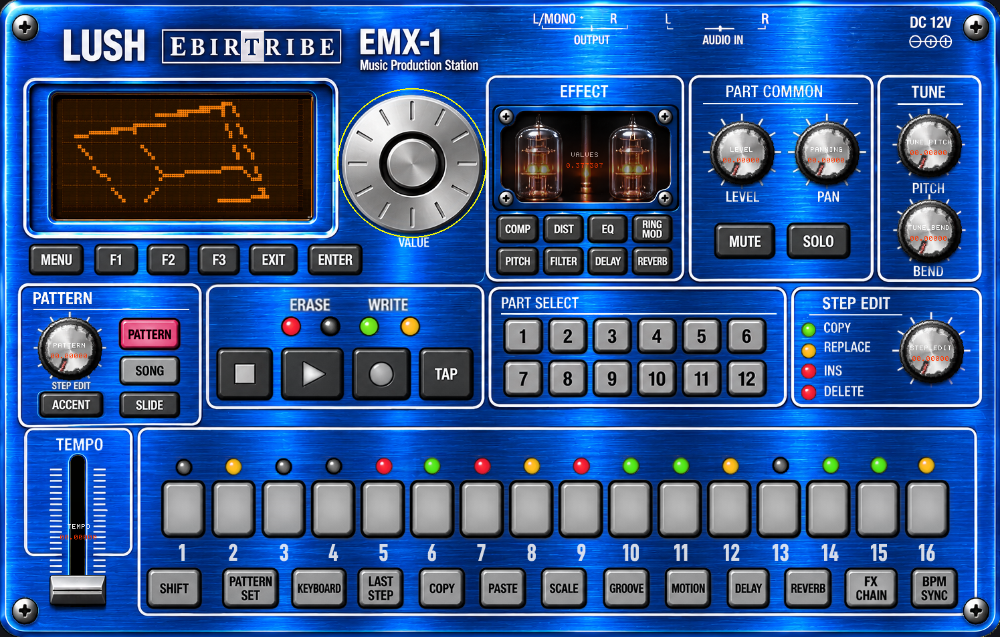

# LUSH EbirTribE EMX-1

**LUSH EbirTribE EMX-1** es un clon software de la caja de ritmos y sintetizador **Korg Electribe EMX-1**, desarrollado en Python. El proyecto reproduce su filosofía de trabajo, su secuenciación y sus capacidades de síntesis mediante una aplicación de escritorio.



## Características

- **Emulación de EMX-1:** lógica de secuenciación y síntesis inspirada en el hardware original.
- **Interfaz gráfica modular:** controles y elementos visuales reutilizables implementados como widgets.
- **Motor de audio integrado:** reproducción de muestras y síntesis en tiempo real (`audio.py`).
- **Sistema de archivos propio:** almacenamiento de patrones, muestras y configuraciones (`filesys.py`).
- **LCD gráfico y tipográfico:** display de cinco filas con modos de texto, mixto y raster Braille.

## Estructura del proyecto

| Archivo / carpeta | Responsabilidad |
|---|---|
| `ebirtribe.py` | Punto de entrada de la aplicación. |
| `app.py` | Orquestación de los sistemas y de la interfaz. |
| `emx.py` | Lógica central y emulación de los componentes de la Electribe. |
| `audio.py` | Motor y procesamiento de audio. |
| `ui.py` | Composición y organización de la interfaz. |
| `interface.py` | Gestión de la interfaz y sus elementos. |
| `widget.py` | Clases de controles gráficos y display LCD. |
| `filesys.py` | Guardado y carga de datos. |
| `resources/` | Imágenes, sprites, tipografías, muestras y otros recursos. |

## Instalación

1. Clona el repositorio:

   ```bash
   git clone https://github.com/pinakure/ebirtribe.git
   cd ebirtribe
   ```

2. Instala las dependencias:

   ```bash
   pip install -r requirements.txt
   ```

## Uso

Ejecuta la aplicación desde la raíz del proyecto:

```bash
python ebirtribe.py
```

---

# Widgets: funcionamiento y API

Los widgets son elementos gráficos independientes que comparten una interfaz común. Se encargan de dibujarse sobre la superficie de la aplicación y, cuando son interactivos, de interpretar los eventos de ratón.

La implementación está en `widget.py`. La aplicación debe proporcionar al widget el objeto `app`, que expone al menos:

- `app.screen`: superficie de Pygame sobre la que se dibuja.
- `app.fonts`: conjunto de fuentes utilizadas por la interfaz.
- `app.resources`: sprites y recursos gráficos.
- `app.pygame`: acceso a las constantes y funciones de Pygame que utiliza la gestión de eventos.

## Interfaz común

La clase base `Widget` define los tipos, la geometría y el estado básico de los controles.

```python
Widget(type, name, x, y, width, height, min, value, max)
```

Atributos importantes:

- `type`: identificador del tipo de widget.
- `name`: nombre mostrado por el widget base.
- `x`, `y`, `width`, `height` y `rect`: posición y geometría.
- `min`, `max`, `value`: rango y valor del control.
- `interactive`: indica si el widget participa en la interacción.
- `uuid`: identificador que puede asignarse mediante `setUUID(uuid)`.

Métodos comunes:

| Método | Función |
|---|---|
| `render(app)` | Dibuja el widget. Cada clase concreta puede especializar el dibujo. |
| `handle(event, app)` | Procesa un evento de Pygame. Devuelve `True` si el widget lo ha atendido. |
| `update()` | Actualiza la geometría o el estado visual dependiente del valor. |
| `demo()` | Comportamiento de demostración, si la clase lo implementa. |
| `setUUID(uuid)` | Asigna el identificador y lo devuelve. |

La clase base también proporciona `mouseDown`, `mouseUp`, `mouseMove`, `touches`, `touchesRect` y `touchesKnob` para simplificar la detección de eventos.

Un bucle de interfaz puede distribuir los eventos entre los widgets y después renderizarlos:

```python
for event in pygame.event.get():
    for widget in widgets:
        if widget.interactive and widget.handle(event, app):
            break

for widget in widgets:
    widget.render(app)
```

Este fragmento ilustra el patrón de uso; la organización concreta del bucle depende de la aplicación.

## Tipos de widget

Los identificadores están definidos como constantes de clase en `Widget`.

| Clase | Constante | Comportamiento |
|---|---|---|
| `Knob` | `Widget.KNOB` | Potenciómetro rotatorio. |
| `Slider` | `Widget.SLIDER` | Control horizontal de valor. |
| `Fader` | `Widget.FADER` | Control vertical de valor. |
| `Button` | `Widget.BUTTON` | Botón momentáneo con callback opcional. |
| `Pad` | `Widget.PAD` | Pad que admite estado propio o callback. |
| `Led` | `Widget.LED` | Indicador de cuatro estados. |
| `Valve` | `Widget.VALVE` | Indicador luminoso con decaimiento visual. |
| `Lcd` | `Widget.LCD` | Display de texto y gráficos Braille. |
| `Vumeter` | `Widget.VUMETER` | Elemento de vumeter; en esta versión dibuja el marco de referencia. |
| `JogWheel` | `Widget.JOG_WHEEL` | Rueda de navegación. |

### Controles de valor

Los controles `Knob`, `Slider` y `Fader` mantienen su valor en `value`, limitado al intervalo `min`–`max`.

```python
knob = Knob(name="CUTOFF", x=100, y=100,
            min=0, value=64, max=127)

slider = Slider(name="LEVEL", x=100, y=220,
                width=200, min=0, value=100, max=127)

fader = Fader(name="VOLUME", x=340, y=100,
              height=200, min=0, value=100, max=127)
```

- **Knob:** se arrastra verticalmente. Mantener `SHIFT` reduce la sensibilidad.
- **Slider:** se arrastra horizontalmente; pulsar sobre la pista coloca el control en esa posición. `SHIFT` reduce la sensibilidad.
- **Fader:** se arrastra verticalmente; pulsar sobre la pista cambia el valor. El extremo inferior representa el mínimo y el superior el máximo.

Los tres actualizan `value` y recalculan su posición visual mediante `update()`.

### Botones y pads

```python
def on_trigger(widget, event, app):
    print("Activado:", widget.name)

button = Button(
    name="PLAY", x=20, y=20, width=128, height=56,
    gfx_pos=(0, 0), value=0, callback=on_trigger
)

pad = Pad(
    name="PAD 1", x=180, y=20, width=96, height=96,
    gfx_pos=(0, 0), value=0
)
```

`Button` activa su valor al pulsar y lo libera al soltar. Si se proporciona `callback`, lo invoca con `(widget, event, app)` al pulsar.

`Pad` resalta visualmente mientras se mantiene pulsado. Sin callback, conmuta su propio valor; con callback, delega en la aplicación la acción asociada.

Los sprites se seleccionan mediante `gfx_pos` y `gfx_size` dentro de `app.resources.buttons`.

### Indicadores

```python
led = Led(name="SYNC", x=20, y=20, kind=0, value=0)
valve = Valve(name="VOICE", x=50, y=20, value=0.0)
```

- **Led:** utiliza `kind` y `value` para seleccionar un sprite. Los cuatro valores documentados son `0` (apagado), `1` (rojo), `2` (ámbar) y `3` (verde).
- **Valve:** `value` representa la intensidad luminosa entre `0.0` y `1.0`. El efecto visual decae progresivamente y puede volver a activarse.

`Led` y `Valve` no son controles interactivos.

### Jog wheel y vumeter

`JogWheel` muestra el recurso gráfico de la rueda y utiliza `value` dentro del rango `min`–`max`. `Vumeter` es un elemento no interactivo; la implementación actual dibuja su marco y deja indicada su futura ampliación.

---

# LCD

El LCD es un widget no interactivo que admite texto y gráficos. Su implementación actual utiliza caracteres Unicode Braille como una matriz compacta de píxeles: **no dibuja los puntos Braille uno a uno con primitivas de Pygame**. Convierte cada bloque de 2 × 4 píxeles en un carácter Unicode y lo entrega a la fuente Braille del proyecto.

La clase es `Lcd` y su buffer gráfico es `RasterBuffer`.

## Geometría física y resolución

Con la configuración habitual de 16 columnas anchas y 5 filas:

| Modo | Área gráfica | Texto / salida |
|---|---:|---|
| Texto | — | 16 caracteres anchos o 32 estrechos por fila, durante 5 filas. |
| Mixto | 64 × 16 píxeles | 4 filas gráficas y una fila inferior de funciones, con 32 caracteres. |
| Raster | 64 × 20 píxeles | Pantalla gráfica completa, empaquetada en 32 caracteres Braille por fila y 5 filas. |

Cada carácter Braille codifica **2 columnas × 4 filas de píxeles**. Por eso, 32 caracteres Braille de ancho representan 64 píxeles, no 32.

Las dimensiones se calculan a partir de `columns` y `rows`:

- Ancho gráfico: `columns * 4` píxeles.
- Alto gráfico Raster: `rows * 4` píxeles.
- Alto gráfico Mixed: 16 píxeles (cuatro filas Braille).
- Ancho de texto estrecho: `columns * 2` caracteres.

## Construcción

```python
lcd = Lcd(
    name="LCD",
    x=20, y=20,
    width=512, height=160,
    columns=16, rows=5,
    skin=0
)
```

Parámetros:

| Parámetro | Descripción |
|---|---|
| `name` | Nombre del widget. |
| `x`, `y` | Posición en pantalla. |
| `width`, `height` | Tamaño visual del display. |
| `columns` | Número de columnas de texto ancho; normalmente 16. |
| `rows` | Número de filas; normalmente 5. |
| `skin` | Índice de apariencia reservado para el display. |

El renderizado utiliza `app.fonts.dot_m` para texto ancho y `app.fonts.dot_xs` para texto estrecho y Braille. La fuente `dot_xs` debe contener los caracteres del bloque Unicode Braille (U+2800–U+28FF).

## Modos de funcionamiento

Los modos están definidos en la propia clase:

```python
Lcd.TEXT_MODE    # 0
Lcd.MIXED_MODE   # 1
Lcd.RASTER_MODE  # 2
```

### 0. Text Mode

Es el modo inicial. Cada una de las cinco filas puede usar independientemente:

- **Ancho:** hasta 16 caracteres, usando `app.fonts.dot_m`.
- **Estrecho:** hasta 32 caracteres, usando `app.fonts.dot_xs`.

```python
lcd.set_line(0, "LUSH EbirTribE", wide=True)
lcd.set_line(1, "PATTERN 01  TEMPO 120")
lcd.set_line(2, "OSC 1      CUTOFF 64")
```

API:

```python
lcd.set_line(row, text, wide=False)
```

`row` debe estar entre `0` y `rows - 1`. `wide=True` selecciona la fuente ancha; por defecto se utiliza la fuente estrecha. El texto se recorta al máximo permitido. La llamada selecciona Text Mode y desactiva la demo automática.

### 1. Mixed Mode

Combina gráficos y texto de funciones:

- Las primeras cuatro filas muestran el raster Braille de 64 × 16 píxeles.
- La quinta fila se reserva para tres etiquetas de función (`F1`, `F2`, `F3`), distribuidas en tres espacios dentro de una línea de 32 caracteres.

```python
lcd.set_mode(Lcd.MIXED_MODE)
lcd.set_functions("OSC", "FILTER", "AMP")
lcd.clear()
lcd.line(0, 15, 63, 0)
```

API de funciones:

```python
lcd.set_functions(f1="", f2="", f3="")
```

Las etiquetas se convierten a texto y se recortan para caber en sus respectivos espacios. La línea inferior se genera automáticamente al renderizar el LCD.

### 2. Raster Mode

Utiliza toda la superficie gráfica: 64 × 20 píxeles. No hay fila de funciones ni área de texto independiente.

```python
lcd.set_mode(Lcd.RASTER_MODE)
lcd.clear()
lcd.circle(32, 10, 8, filled=False)
lcd.line(0, 0, 63, 19)
```

Es el modo apropiado para visualizaciones a pantalla completa, animaciones, formas geométricas, espectros o mapas de píxeles.

## API gráfica

Los métodos de dibujo de `Lcd` son accesos directos al `RasterBuffer` activo:

| Método | Descripción |
|---|---|
| `set_mode(mode)` | Selecciona Text, Mixed o Raster. |
| `clear(value=0)` | Limpia el raster (`0`) o lo rellena (`1`). |
| `plot(x, y, value=1)` | Enciende o apaga un píxel. |
| `line(x0, y0, x1, y1, value=1)` | Dibuja una línea entre dos puntos. |
| `circle(cx, cy, rx, ry=None, filled=False, value=1)` | Dibuja una elipse o una elipse rellena. |
| `set_functions(f1, f2, f3)` | Actualiza las tres etiquetas de la fila inferior de Mixed Mode. |

Los métodos devuelven el propio LCD, por lo que se pueden encadenar:

```python
lcd.set_mode(Lcd.RASTER_MODE)
lcd.clear().line(0, 0, 63, 19).circle(32, 10, 6)
```

Las coordenadas comienzan en `(0, 0)`, en la esquina superior izquierda. Los puntos fuera de los límites del buffer se ignoran. `value=0` permite borrar puntos o trazos.

### RasterBuffer

`lcd.raster` expone el buffer de píxeles activo. También se puede utilizar directamente:

```python
raster = lcd.raster
raster.plot(10, 5)
raster.line(0, 0, 63, 15)
raster.circle(32, 8, 5)
```

Métodos disponibles:

- `clear(value=0)`: rellena el buffer.
- `plot(x, y, value=1)`: modifica un píxel.
- `line(x0, y0, x1, y1, value=1)`: línea mediante algoritmo incremental.
- `circle(cx, cy, rx, ry=None, filled=False, value=1)`: elipse de radio horizontal `rx` y vertical `ry`; si `ry` se omite, se utiliza `rx`.
- `get()`: devuelve una lista de cadenas, una por fila de caracteres Braille.

El empaquetado asigna los ocho puntos de cada carácter Braille a sus posiciones Unicode correspondientes. Los bloques de 2 × 4 píxeles se convierten en un único carácter U+2800–U+28FF. El LCD dibuja esas cadenas con la fuente `dot_xs`.

### Ejemplo completo: visualización raster

```python
lcd.set_mode(Lcd.RASTER_MODE)
lcd.clear()

# Marco
lcd.line(0, 0, 63, 0)
lcd.line(0, 19, 63, 19)
lcd.line(0, 0, 0, 19)
lcd.line(63, 0, 63, 19)

# Gráfico central
lcd.circle(32, 10, 12, 7)
lcd.line(8, 10, 56, 10)
```

### Compatibilidad con `buffer`

La propiedad `lcd.buffer` se conserva como vista de compatibilidad:

- En Text Mode devuelve las líneas de texto.
- En Mixed Mode devuelve las cuatro filas Braille y la línea inferior de funciones.
- En Raster Mode devuelve las filas Braille completas.

Asignar una lista a `lcd.buffer` vuelve a seleccionar Text Mode y copia sus líneas. Para código nuevo se recomienda utilizar `set_line`, `set_mode` y la API gráfica directamente.

## Demo integrada del LCD

`demo_64.py` contiene `LcdDemo`, una demostración animada que utiliza la misma API pública del LCD. Incluye escenas de fuego, estrellas, geometría, Pong, vumetros, formas de onda, muestras, imágenes y texto.

Las escenas gráficas dibujan sobre `lcd.raster`; no implementan un segundo canvas ni rasterizan los puntos Braille manualmente. La escena de fuego actualiza su autómata celular aproximadamente a 30 FPS.

Al llamar a `set_mode()` o `set_line()` desde la aplicación, el LCD desactiva la demo automática para dejar el control al programa. La demo integrada puede mantenerla activa durante sus propias animaciones.

---

## Consideraciones de desarrollo

- Mantén disponibles los recursos gráficos y las fuentes que espera cada widget (`app.resources` y `app.fonts`).
- Para el LCD, comprueba que `dot_xs` incluye el bloque Braille Unicode completo.
- No sustituyas los caracteres personalizados del logo o de `GLYPHS` por aproximaciones visuales: forman parte del diseño de la interfaz.
- Las coordenadas del raster se expresan en píxeles lógicos, no en píxeles de la ventana de Pygame.
- `Lcd` no recibe eventos de ratón: su contenido se modifica desde el código que controla la interfaz.

## Licencia

Este proyecto se distribuye bajo la licencia **MIT**. Consulta el archivo `LICENSE` para conocer sus términos.
